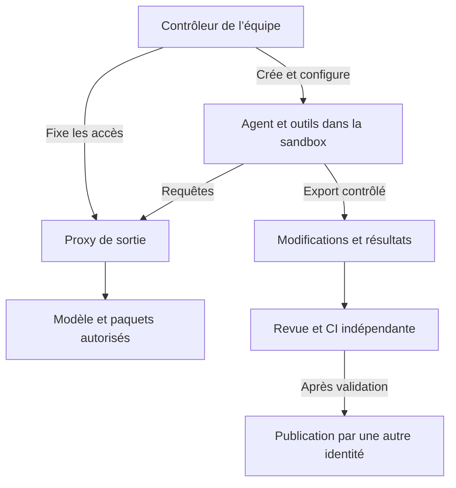

>  ⚠️ OUVRIR LE FICHIER AVANT PUBLICATION + IMAGE

## Préambule

Un agent de développement peut analyser une solution, modifier des projets, restaurer des dépendances et lancer des tests. Dans un scénario de modernisation, cette autonomie permet d’enchaîner plusieurs tâches qui demanderaient autrement de nombreuses interventions manuelles.

Ces opérations utilisent toutefois les fichiers, les outils et les accès disponibles dans l’environnement d’exécution. Une commande lancée avec les permissions du développeur peut atteindre beaucoup plus que le dépôt à moderniser.

La session [Protect your PC from AI coding agents while modernising legacy .NET apps de .NET Conf 2026](https://www.youtube.com/watch?v=OoALkRag2tY) compare trois approches pour définir ces limites. La session [Azure’s new lineup for .NET developers](https://www.youtube.com/watch?v=o6hODySxDTA) montre aussi comment isoler les outils qu’un agent exécute.

Après avoir couvert plusieurs nouveautés de [.NET 11](https://codewithfrenchy.com/posts/dotnet11/), je m’intéresse ici à l’environnement dans lequel on confie ces changements à un agent.

L’objectif est de comparer les options locales et Azure Container Apps, puis de construire une démarche applicable à une modernisation .NET. Les configurations et comportements mentionnés correspondent à la documentation consultée le 17 novembre 2026. Le scénario décrit est illustratif, sans prétendre rapporter une migration exécutée pour cet article.

## Autoriser une commande et limiter ses accès sont deux décisions

Une approbation répond à une question précise. Est-ce que cet outil peut être exécuté ?

L’isolation répond à une autre question. Une fois exécuté, à quels fichiers, processus, services et identités peut-il accéder ?

Réduire les demandes d’approbation ne réduit pas automatiquement les permissions du processus. De même, une instruction dans un fichier `AGENTS.md` peut orienter le comportement de l’agent, mais elle ne constitue pas un contrôle d’accès du système d’exploitation.

Le dépôt lui-même fait partie des éléments à examiner. Une compilation ou un test peut exécuter du code provenant de scripts, de tâches MSBuild ou de dépendances. La frontière doit donc couvrir les processus lancés par les outils, y compris lorsque la commande initiale paraît habituelle.

Pour une équipe, le bénéfice recherché est de permettre à l’agent de travailler dans un espace défini, avec des accès adaptés à sa mission. Les interruptions deviennent alors plus utiles, car elles portent sur de véritables changements de périmètre.

## Trois approches, trois périmètres d’isolation

| Approche | Lieu d’exécution | Gain principal | Point à vérifier |
| --- | --- | --- | --- |
| Sandbox locale de GitHub Copilot CLI | Poste du développeur, avec des restrictions du système d’exploitation | Réutiliser les outils installés avec des accès limités | Portée réelle de la politique et outils exécutés hors du processus isolé |
| Docker Sandboxes en local | MicroVM Linux sur le poste | Séparer le noyau et les outils de l’environnement hôte | Répertoires partagés, réseau et services accessibles depuis la microVM |
| Azure Container Apps Sandboxes | MicroVM Linux dans Azure | Déplacer le calcul et organiser les environnements pour une équipe | Identités, sorties réseau, conservation des données et coûts |

Un répertoire de travail Git distinct aide à séparer les changements. Il ne limite pas à lui seul les permissions d’une commande. La [configuration locale de Copilot](https://docs.github.com/en/copilot/how-tos/cloud-and-local-sandboxes/configuring-local-sandbox-settings) distingue d’ailleurs ces deux fonctions.

### Une sandbox locale pour conserver les outils du poste

Le [modèle local de Copilot CLI](https://docs.github.com/en/copilot/concepts/security-governance-and-network-settings/about-cloud-and-local-sandboxes) applique des restrictions aux commandes et aux processus concernés. Il ne les place pas dans une machine virtuelle distincte.

La CLI elle-même reste sur le poste. Ses outils intégrés de lecture et de modification des fichiers vérifient la politique dans leur propre code. Ils ne bénéficient pas du même contrôle par le système d’exploitation que les processus enfants isolés.

Dans une session interactive, les commandes suivantes permettent d’activer puis d’examiner la configuration.

```text
/sandbox enable
/sandbox status
/sandbox policy
/sandbox policy dotnet build
```

La dernière commande inspecte les accès associés à la commande, sans lancer la compilation. Les [instructions d’utilisation](https://docs.github.com/en/copilot/how-tos/cloud-and-local-sandboxes/using-local-sandboxing) précisent également les prérequis selon le système.

Cette approche peut convenir à une application qui dépend encore d’outils Windows. Il faut cependant vérifier que le poste et sa version du système prennent en charge les restrictions attendues. Une configuration adaptée doit aussi couvrir les caches, les dossiers temporaires et les chemins nécessaires aux outils.

### Une microVM locale pour séparer davantage l’exécution

[Docker Sandboxes](https://docs.docker.com/ai/sandboxes/security/isolation/) place l’agent dans une microVM avec son propre noyau Linux et son propre moteur Docker. Les conteneurs démarrés depuis cette microVM utilisent ce moteur, sans nécessiter le partage du socket Docker du poste.

Le mode de partage des fichiers demeure un choix essentiel. Un montage direct permet à l’agent de modifier les fichiers du répertoire hôte. Le mode `--clone` lui fournit une copie de travail privée.

Cette isolation convient bien aux tâches compatibles avec Linux. Elle consomme toutefois les ressources du poste et ne rend pas une ancienne application Windows exécutable sous Linux.

### Une sandbox Azure pour partager la capacité et le contrôle

Les [Azure Container Apps Sandboxes, annoncées en disponibilité générale](https://techcommunity.microsoft.com/blog/appsonazureblog/azure-container-apps-sandboxes-now-generally-available/4559125), fournissent des microVM isolées matériellement avec leur propre noyau Linux.

Le poste sert alors à préparer la mission et à examiner les résultats. L’exécution peut continuer dans Azure sans mobiliser sa capacité de calcul.

Il faut distinguer cette offre des applications Container Apps, des jobs et des Dynamic Sessions. La [présentation du service](https://learn.microsoft.com/en-us/azure/container-apps/sandboxes-overview) décrit les sandboxes comme des environnements dont on contrôle directement le cycle de vie et l’état. Elles ne sont pas simplement un autre nom pour les pools de sessions.

## Le scénario : moderniser une application qui dépend encore de Windows

Prenons une application ASP.NET MVC 5 sur .NET Framework 4.8. Elle utilise IIS Express, SQL Server LocalDB et MSMQ. L’équipe souhaite extraire progressivement des services métier et construire une cible ASP.NET Core sur .NET 11.

Une sandbox Linux peut lire les sources, produire un inventaire et travailler sur les composants devenus compatibles. Elle ne peut pas valider à elle seule le comportement de l’application historique et de ses dépendances Windows.

Je séparerais donc le travail en trois étapes.

| Étape | Environnement | Résultat attendu |
| --- | --- | --- |
| Établir le comportement actuel | Environnement Windows contrôlé | Compilation de référence, tests existants et inventaire des dépendances |
| Moderniser un composant délimité | Sandbox locale ou Azure compatible avec la cible | Modifications, tests du composant et liste des incompatibilités restantes |
| Vérifier l’intégration | Pipeline indépendant avec les environnements nécessaires | Validation métier, intégration et comparaison avec le comportement attendu |

Pour un poste dont les restrictions locales sont insuffisantes, je privilégierais un environnement Windows dédié à la validation historique. L’accès au poste quotidien du développeur ne devrait pas devenir la solution par défaut à chaque dépendance difficile à reproduire.

La première mission de l’agent pourrait être limitée à l’extraction d’un calcul métier. Elle n’aurait besoin ni d’un accès à la production ni d’une permission de publication.

## Définir le contrat d’exécution avant le démarrage

Pour cette mission, je préparerais les paramètres suivants dans un espace contrôlé par l’équipe.

| Dimension | Décision pour le scénario |
| --- | --- |
| Sources | Copie propre d’un commit identifié |
| Outils | Image préparée avec les versions nécessaires du SDK et de la CLI |
| Écriture | Copie de travail, fichiers temporaires et répertoire de résultats |
| Dépendances | Flux NuGet approuvés et données synthétiques |
| Secrets | Aucun secret de production et aucun jeton permettant de publier |
| Réseau | Destinations nécessaires explicitement autorisées |
| Durée | Limite de travail imposée par le contrôleur et politique de nettoyage |
| Sortie | Modifications proposées, résultats de tests et problèmes non résolus |

La politique doit être appliquée avant la première commande. La conserver uniquement dans un fichier que l’agent peut modifier ne suffit pas.

L’architecture proposée sépare l’exécution, le contrôle des communications et la publication des résultats.



Le contrôleur représente ici le service ou l’automatisation de confiance qui crée l’environnement, applique les limites et récupère les résultats. Son identité et ses permissions ne sont pas transmises au processus de travail.

## Système de fichiers : une copie accessible reste une copie lisible

La première protection consiste à fournir uniquement ce qui est nécessaire à la mission.

Je préparerais une copie propre des sources, sans les fichiers de configuration personnels, les clés SSH, les profils Azure ou les chaînes de connexion utilisées sur le poste. Les fichiers suivis par Git doivent aussi être examinés. Un secret versionné reste un secret exposé.

Un détail de Docker mérite une attention particulière. Dans le [mode clone](https://docs.docker.com/ai/sandboxes/workflows/git/), l’agent travaille sur une copie privée, mais le répertoire source monté en lecture seule reste consultable. La [documentation de l’isolation](https://docs.docker.com/ai/sandboxes/security/isolation/#clone-mode) précise que cela inclut les fichiers non suivis et ceux exclus par `.gitignore`.

Un fichier `.env` ignoré par Git peut donc rester lisible. Le mode clone protège le répertoire hôte contre les modifications, pas contre la lecture de son contenu.

Pour Copilot CLI en local, les [politiques du système de fichiers](https://docs.github.com/en/copilot/concepts/security-governance-and-network-settings/understanding-local-sandboxing) ajoutent aussi des accès nécessaires aux outils et à certains caches. Je vérifierais la politique effective au lieu de supposer que seul le dossier visible dans l’éditeur est accessible.

### Séparer les caches utiles des données de la mission

Un cache de paquets peut accélérer les restaurations. Un répertoire de profil partagé peut aussi exposer une configuration d’authentification ou mélanger les modifications de plusieurs missions.

Je privilégierais un cache initial préparé à partir de sources approuvées, puis une zone d’écriture propre à chaque exécution. Les scripts, les hooks et les caches modifiés par un agent ne devraient pas devenir automatiquement le point de départ du prochain.

Le gain recherché est la reproductibilité. On doit pouvoir relancer la mission à partir du même commit et du même environnement, sans dépendre des changements laissés par une exécution précédente.

## Secrets : permettre un usage précis sans distribuer la valeur

Une variable d’environnement contenant un vrai secret reste généralement lisible par le processus auquel elle est transmise. Le placement dans une sandbox ne change pas cette propriété.

Pour les services compatibles, un proxy peut ajouter l’authentification à la sortie. La [gestion des identifiants de Docker Sandboxes](https://docs.docker.com/ai/sandboxes/configuration/credentials/) prévoit ce fonctionnement. Le secret géré par le proxy reste sur l’hôte et l’environnement isolé utilise une valeur de remplacement.

Azure Container Apps propose également des [transformations de requêtes](https://learn.microsoft.com/en-us/azure/container-apps/sandboxes-egress-policies#header-transforms-and-credential-injection) pour ajouter un en-tête depuis un secret ou une identité managée. L’agent peut ainsi appeler un service autorisé sans recevoir directement sa clé.

Cela ne retire pas le pouvoir associé au service. Un agent qui ne connaît pas la valeur du jeton peut néanmoins effectuer les opérations permises par ce jeton à travers le proxy.

Pour notre mission, je distinguerais donc les accès suivants.

| Besoin | Permission à prévoir |
| --- | --- |
| Lire les paquets privés | Lecture du flux nécessaire |
| Appeler le modèle | Accès au déploiement approuvé, avec limites d’utilisation |
| Consulter les sources | Lecture du dépôt concerné, si la copie n’est pas fournie directement |
| Publier une branche ou un paquet | Permission conservée par une étape distincte |
| Accéder à la production | Aucun accès pour cette mission |

Les journaux demandent la même attention. Une commande qui affiche sa configuration peut divulguer des données sensibles dans un rapport, même si aucun fichier n’est exporté volontairement.

## Réseau : définir ce qui peut sortir dès la création

L’isolation du calcul ne garantit pas que les communications sortantes sont restreintes. Par exemple, la documentation de Copilot CLI indique que l’accès Internet sortant est activé par défaut dans sa sandbox locale.

Dans Azure Container Apps, les [politiques de sortie](https://learn.microsoft.com/en-us/azure/container-apps/sandboxes-egress-policies) peuvent définir une action par défaut et des règles sur les destinations, les chemins et les méthodes HTTP. La première règle correspondante s’applique.

Pour notre phase de modification et de tests unitaires, je partirais d’un refus par défaut. Les seules destinations autorisées seraient celles du modèle, des paquets et des services indispensables à l’outillage.

Le mode d’inspection compte également. Le mode `Full` bloque le trafic non HTTP. Le mode `Partial` peut laisser passer ce trafic et `None` désactive l’application des règles. Une liste de domaines ne suffit donc pas à décrire la protection effective.

Ce choix a une conséquence pratique. Une connexion SQL directe vers une base de données distante ne fait pas partie de ce profil HTTP. Les tests d’intégration qui en ont besoin sont exécutés dans une étape dédiée avec une politique adaptée au protocole, sans assouplir silencieusement celle de la mission initiale.

### Autoriser une destination ne valide pas toutes les données envoyées

Un service de modèle autorisé reçoit potentiellement du code, des extraits de journaux et des résultats d’outils. Ces transferts doivent être acceptables pour le dépôt concerné.

De même, une plateforme Git autorisée peut héberger d’autres dépôts. Les permissions du jeton, les chemins autorisés et les opérations disponibles doivent limiter l’usage au besoin réel.

Je commencerais avec une image contenant les outils nécessaires et un flux de paquets maîtrisé. Cela réduit le besoin d’autoriser de nombreuses destinations de téléchargement pendant chaque mission. Les redirections et les points de terminaison d’authentification doivent être vérifiés lors de la préparation.

Un refus réseau fournit une information utile. Il permet d’identifier une dépendance oubliée ou une action extérieure au périmètre. La correction consiste à comprendre ce besoin avant d’élargir la règle.

Les accès entrants demandent une décision distincte. Si une mission nécessite un aperçu HTTP de l’application modernisée, je limiterais les ports exposés et l’accès aux réviseurs autorisés. Une politique de sortie ne protège pas un serveur de développement publié sans authentification.

## Les outils MCP peuvent déplacer l’action hors de la sandbox

L’emplacement de l’agent ne suffit pas à déterminer l’emplacement de toutes ses actions.

Un serveur MCP distant peut modifier un dépôt, créer une ressource Azure ou interroger une base de données avec sa propre identité. Ces opérations sont exécutées par ce service, en dehors de la machine qui héberge l’agent.

Même un outil qualifié de local peut se trouver sur l’hôte. Docker précise par exemple que les serveurs MCP `stdio` enregistrés par sa passerelle MCP s’exécutent sur l’hôte, hors de la microVM. Le [modèle de sécurité](https://docs.docker.com/ai/sandboxes/security/) et la configuration de la passerelle doivent donc être examinés ensemble.

Pour notre modernisation, je dresserais la liste des outils disponibles avec leur lieu d’exécution, leur identité et leurs opérations autorisées. Un outil de lecture du dépôt peut être utile. Un outil de déploiement disposant d’un rôle étendu n’est pas nécessaire à l’extraction d’un calcul métier.

Les skills et les instructions décrivent comment travailler. Les permissions du service, la politique d’exécution et les contrôles réseau définissent ce que les outils peuvent réellement faire.

## Dans Azure, séparer les droits de contrôle des droits de travail

Les ressources d’une sandbox appartiennent à un groupe de sandboxes. Ce groupe définit notamment un périmètre partagé pour les images, les instantanés, les volumes et les secrets.

Le rôle `Container Apps SandboxGroup Data Owner` donne accès aux opérations de gestion des sandboxes. La [documentation de démarrage](https://learn.microsoft.com/en-us/azure/container-apps/sandboxes-get-started) précise les permissions nécessaires, tandis que la présentation du service décrit leur attribution au périmètre du groupe.

Je réserverais ce rôle au contrôleur et aux personnes qui administrent les environnements. Le processus chargé de modifier le code ne doit pas recevoir les permissions qui lui permettraient d’élargir sa politique ou d’examiner les ressources d’autres missions.

Des groupes distincts peuvent être nécessaires pour séparer des équipes ou des niveaux de sensibilité. Une microVM isolée n’annule pas un droit administratif qui permet d’accéder aux fichiers ou aux instantanés d’une autre sandbox.

L’accès réseau privé doit également être volontaire. Raccorder un environnement au réseau de l’entreprise peut lui donner de nouvelles destinations atteignables. Pour notre scénario, aucun accès au réseau de production n’est requis.

## Gérer la durée de vie autant que le démarrage

Le [cycle de vie des sandboxes Azure Container Apps](https://learn.microsoft.com/en-us/azure/container-apps/sandboxes-snapshots-state-management) permet de suspendre une activité et de reprendre son état. Selon le mode choisi, la conservation concerne la mémoire et le disque, ou uniquement le disque. Des volumes de données attachés imposent le mode disque.

La suppression automatique après inactivité et les instantanés répondent à des besoins différents. Un instantané peut servir de point de reprise ou de source pour créer une nouvelle sandbox. Il conserve aussi les données présentes dans l’environnement.

Pour un premier pilote, je fixerais les règles suivantes. Il s’agit de choix d’équipe, à ajuster après mesure.

| Moment | Règle proposée |
| --- | --- |
| Création | Une mission, un identifiant, un commit source et une image identifiée |
| Exécution | Durée maximale de 60 minutes imposée par le contrôleur |
| Attente | Suspension après une période d’inactivité adaptée au travail |
| Reprise | Vérification de la politique et renouvellement des accès nécessaires |
| Fin | Export des résultats, puis suppression de l’environnement |
| Conservation | Durée explicite pour les rapports, volumes et instantanés |

Une politique fondée sur l’inactivité ne remplace pas une durée maximale. Un processus qui reste actif peut continuer à consommer des ressources. Le contrôleur doit aussi pouvoir interrompre la mission et nettoyer après un échec.

La suppression d’une sandbox n’efface pas les changements effectués dans un service externe. Un instantané ne revient pas non plus sur une publication, une écriture dans une base de données ou un message déjà envoyé.

Je conserverais les environnements préparés sans secrets de mission. Réutiliser un instantané pris après un travail sensible peut recopier les fichiers, l’historique et l’état laissés par ce travail.

## Vérifier les limites avant de lancer la modernisation

La politique doit être testée avec des données factices. Il n’est pas nécessaire d’utiliser un vrai secret ou un service de production pour vérifier un refus.

| Vérification | Résultat attendu |
| --- | --- |
| Créer un fichier dans la copie de travail | Autorisé |
| Lire et modifier un fichier témoin hors du périmètre | Refusé |
| Restaurer un paquet depuis le flux approuvé | Autorisé |
| Joindre une destination témoin non autorisée | Refusé |
| Utiliser un protocole réseau non prévu | Refusé |
| Lire la valeur réelle d’un secret géré par le proxy | Valeur absente du processus |
| Modifier la politique depuis le processus de travail | Refusé |
| Reprendre après suspension | Contrôles toujours applicables |

Vérifier uniquement que le fichier témoin n’a pas changé ne démontre pas qu’il était illisible. Les accès en lecture et en écriture doivent être examinés séparément.

Je conserverais les résultats de ces contrôles avec les versions des outils et de la politique. Une modification de l’image, de la CLI ou des règles justifie de les rejouer.

Azure propose aussi la [collecte de décisions réseau et de journaux](https://techcommunity.microsoft.com/blog/appsonazureblog/azure-container-apps-sandboxes-now-generally-available/4559125). Leur export doit être configuré. Ces traces permettent d’expliquer un blocage et de relier une action à une mission, sans supposer que tous les détails sont conservés automatiquement.

## Accepter les résultats sans transporter tout l’environnement

À la fin de la mission, l’agent produit les modifications proposées, les tests ajoutés, les résultats obtenus et les limites de sa validation.

L’équipe examine le diff, mais aussi les changements aux fichiers de compilation, aux scripts et aux configurations de pipeline. Ces fichiers peuvent exécuter du code lorsqu’un développeur ouvre le projet ou lorsqu’une CI le prend en charge.

Je transférerais les changements de source par un mécanisme contrôlé, sans recopier les caches, les profils ou le répertoire `.git` complet de l’environnement de travail.

Une CI indépendante reconstruit ensuite le résultat dans un environnement propre, avec une configuration contrôlée et sans secrets de publication. Elle exécute aussi les validations Windows et les tests d’intégration que la sandbox Linux ne pouvait pas couvrir.

Le fait que l’agent ait exécuté des tests avec succès reste une information utile. La validation indépendante permet de vérifier ce résultat sans réutiliser tout l’état de son environnement.

## Mesurer les gains possibles

Je comparerais les approches sur une même mission, avec le même commit initial et les mêmes critères d’acceptation.

Les indicateurs utiles seraient le temps de préparation, le temps total de validation, les interruptions nécessaires, la capacité à reprendre une mission et le coût par changement accepté.

Le local peut être avantageux lorsque les outils Windows et les dépendances existent déjà sur le poste. Une microVM locale permet de séparer davantage l’exécution tout en conservant une boucle de travail proche du développeur. Azure facilite la mise à disposition d’environnements reproductibles et les travaux simultanés, avec une administration et un coût à prévoir.

Le temps de démarrage de la machine ne suffit pas à mesurer ce gain. La restauration des paquets, les tests et la revue peuvent représenter l’essentiel du délai.

## Conclusion

Isoler un agent de développement consiste à définir l’environnement dans lequel ses outils peuvent agir, puis à vérifier que cette frontière tient pendant toute la mission.

Le choix entre une sandbox locale, une microVM sur le poste et Azure Container Apps dépend de la compatibilité des outils, des accès nécessaires et du mode de collaboration de l’équipe.

Pour une modernisation .NET, je partirais d’une copie propre, d’une mission délimitée et de permissions minimales. Les secrets, le réseau, les outils externes et les instantanés doivent faire partie de cette conception dès le départ.

Cette démarche permet de confier davantage de travail à un agent tout en conservant des changements examinables, une validation indépendante et un environnement dont on maîtrise la fin de vie.
