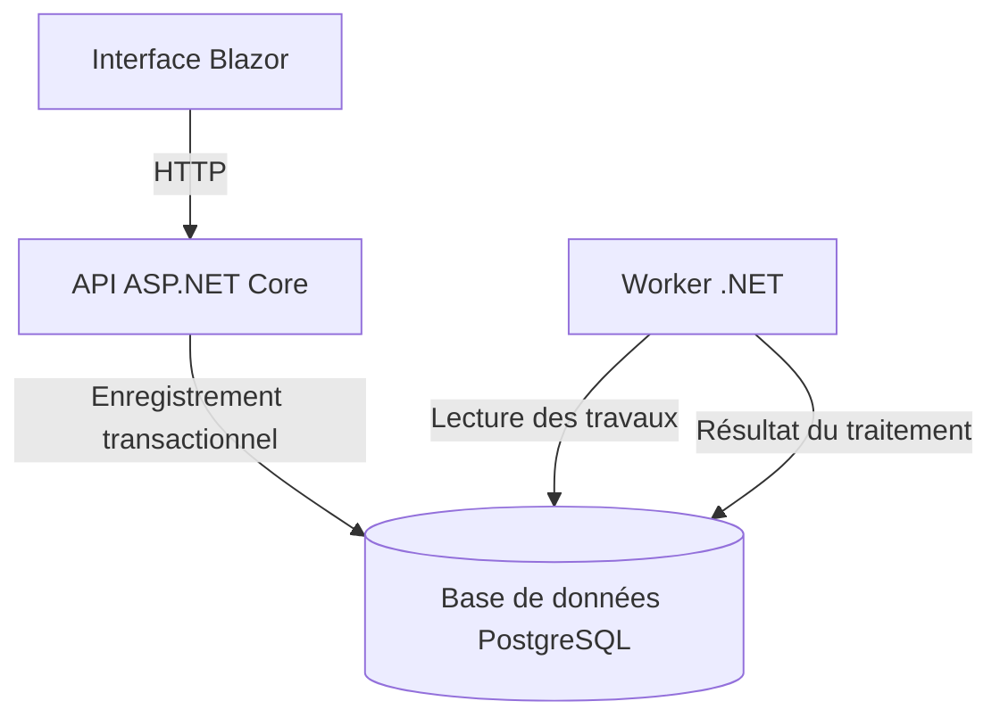

>  ⚠️ OUVRIR LE FICHIER AVANT PUBLICATION + IMAGE

## Préambule

Une application métier dépasse souvent le projet qui reçoit les requêtes HTTP. Il faut aussi démarrer une interface, préparer une base de données et lancer un traitement en arrière-plan. Lorsqu’un parcours échoue, le problème peut se trouver dans n’importe lequel de ces composants.

La difficulté augmente lorsque les commandes de démarrage, les ports et les paramètres sont répartis entre plusieurs fichiers ou conservés dans les habitudes de l’équipe. Le temps consacré à reproduire l’environnement retarde celui que l’on peut consacrer au problème.

Dans la session [What’s New in Aspire for .NET Developers de .NET Conf 2026](https://www.youtube.com/watch?v=wVq9fIXsVWE), l’équipe présente l’évolution d’Aspire autour de la composition des applications, du tableau de bord et du travail avec les agents.

Après avoir couvert plusieurs nouveautés de [.NET 11](https://codewithfrenchy.com/posts/dotnet11/), je m’intéresse ici à un autre gain : rendre une application complète plus facile à démarrer, à observer et à vérifier.

Le fil conducteur sera une application de gestion de commandes. Le billet détaille les raccordements et la démarche de diagnostic, sans développer toute sa logique métier. Les scénarios décrits sont illustratifs, pas des mesures réalisées sur une application de production.

Les commandes présentées s’appuient sur les fonctionnalités documentées d’Aspire 13.6. La session montre également des changements préparés pour Aspire 17. Le cycle de version d’Aspire reste distinct de celui de .NET.

## Une application avec quatre composants

Notre solution comprend les éléments suivants.

| Composant | Nom de ressource | Responsabilité |
| --- | --- | --- |
| Interface Blazor avec interactivité côté serveur | `interface` | Saisir une commande et consulter son état en appelant l’API |
| API ASP.NET Core | `api` | Valider la demande et enregistrer la commande à traiter |
| Base de données PostgreSQL | `commandes` | Conserver les commandes et les travaux en attente |
| Worker .NET | `worker` | Prendre en charge les travaux et enregistrer leur résultat |

Le serveur PostgreSQL est lui-même une ressource nommée `postgres`. `commandes` désigne la base de données qu’il héberge.



Lorsqu’une commande est soumise, l’API enregistre la commande et le travail associé dans une même transaction. Elle retourne un statut HTTP `202 Accepted` avec un identifiant. Le worker récupère ensuite le travail et fait passer la commande de `EnAttente` à `Traitee`.

Ce choix utilise une table de travaux persistante pour conserver quatre composants principaux. La prise en charge concurrente des travaux, les reprises et l’idempotence restent des responsabilités de l’application.

Le critère de réussite est donc plus exigeant qu’une réponse HTTP positive. La commande doit atteindre son état final et son effet métier doit être enregistré une seule fois.

## Décrire les dépendances dans l’AppHost

L’[AppHost](https://aspire.dev/get-started/app-host/) décrit les ressources et leurs relations. Il rassemble l’information nécessaire pour lancer l’application localement et fournir aux composants les paramètres de leurs dépendances.

Dans une solution existante, la commande [aspire init](https://aspire.dev/reference/cli/commands/aspire-init/) peut préparer cette intégration.

```bash
aspire init --language csharp
```

Le résultat dépend de la structure du dépôt. Lorsqu’une solution .NET est détectée, l’initialisation peut créer un projet AppHost et des références aux projets existants. Il faut ensuite examiner les raccordements proposés et ajouter les dépendances qui manquent.

Pour notre application, voici les éléments à déclarer dans l’AppHost.

| Ressource | Configuration à exprimer |
| --- | --- |
| `postgres` | Serveur créé avec `AddPostgres`, image maîtrisée et volume de données local |
| `commandes` | Base de données déclarée avec `AddDatabase` sur le serveur PostgreSQL |
| `api` | Projet .NET, référence à `commandes`, attente de PostgreSQL et contrôle de santé HTTP |
| `worker` | Projet .NET, référence à `commandes` et attente de PostgreSQL |
| `interface` | Projet Blazor, référence à `api` et contrôle de santé HTTP |

Trois opérations méritent d’être distinguées.

`WithReference` transmet la configuration nécessaire pour joindre une dépendance. `WaitFor` encadre le démarrage en fonction de son état. `WaitForCompletion` attend la fin réussie d’une opération ponctuelle, comme une migration.

Une référence ne suffit donc pas à garantir que le composant distant est prêt. De même, PostgreSQL peut accepter les connexions alors que le schéma de l’application n’a pas encore été créé.

Pour les migrations, j’ajouterais une ressource d’initialisation qui s’exécute une seule fois. L’API et le worker attendraient sa réussite avant de démarrer, suivant le modèle documenté pour les [migrations EF Core avec Aspire](https://aspire.dev/integrations/databases/efcore/migrations/). Cette étape ne devient pas un service métier supplémentaire à maintenir en fonctionnement.

La présentation de .NET Conf montre aussi l’évolution vers `AddDotnetProject`, qui référence un projet par son chemin. L’[intégration .NET](https://aspire.dev/integrations/frameworks/dotnet/dotnet-host/) documente cette approche. Son intérêt est de permettre à Aspire de prendre en charge le lancement des projets sans imposer toutes leurs compilations avant l’ouverture de l’AppHost.

## Réduire le travail nécessaire au démarrage local

### Préparer une fois, puis partager le même modèle

Les [prérequis du poste](https://aspire.dev/get-started/prerequisites/) comprennent la CLI Aspire, le SDK .NET requis par les projets et un moteur de conteneurs compatible pour PostgreSQL. Le dépôt devrait aussi préciser les versions utilisées et les éventuels prérequis réseau ou certificats.

L’[intégration PostgreSQL](https://aspire.dev/integrations/databases/postgres/postgres-get-started/) distingue deux responsabilités. L’intégration d’hébergement déclare le serveur dans l’AppHost. L’intégration cliente permet à chaque application de s’y connecter.

Dans notre cas, l’API et le worker peuvent utiliser `Aspire.Npgsql.EntityFrameworkCore.PostgreSQL`. L’enregistrement avec `AddNpgsqlDbContext<CommandesDbContext>` doit utiliser le nom de connexion `commandes`, comme l’explique la [configuration du client EF Core](https://aspire.dev/integrations/databases/efcore/postgres/postgresql-connect/).

L’interface appelle l’API par son nom logique à travers la [découverte de services](https://aspire.dev/fundamentals/service-discovery/) configurée pour son client HTTP. Dans ce scénario Blazor, cet appel part du serveur. Pour une interface exécutée dans le navigateur, il faudrait aussi configurer une adresse accessible au navigateur ou un proxy.

Le gain pour l’équipe est concret. Les ports attribués et les informations de connexion ne doivent plus être recopiés manuellement dans chaque composant. Les changements de dépendances peuvent être relus avec le code.

### Démarrer et vérifier la disponibilité

Depuis le répertoire de l’AppHost, une session interactive peut être lancée ainsi.

```bash
aspire run
```

Pour conserver le terminal disponible, [aspire start](https://aspire.dev/reference/cli/commands/aspire-start/) démarre l’AppHost en arrière-plan.

```bash
aspire start
aspire wait api --status healthy --timeout 120
aspire wait interface --status healthy --timeout 120
aspire wait worker --status up --timeout 120
```

Les deux modes sont des alternatives. Il n’est pas nécessaire de démarrer deux fois le même AppHost.

La distinction entre `healthy` et `up` est volontaire. La commande [aspire wait](https://aspire.dev/reference/cli/commands/aspire-wait/) peut considérer une ressource en fonctionnement comme saine lorsqu’aucun contrôle de santé n’est configuré. Notre worker n’expose pas automatiquement un point de terminaison HTTP simplement parce qu’il existe dans l’AppHost.

Il faut donc prévoir un signal propre au worker, par exemple la progression des traitements et l’âge du plus ancien travail en attente. Un processus vivant peut rester bloqué sur une opération ou répéter la même erreur.

### Choisir ce qui persiste entre deux exécutions

Un volume PostgreSQL facilite la reprise du travail local. Il permet aussi de conserver un état qui masque un problème d’initialisation.

Je garderais deux parcours documentés : un démarrage avec les données locales existantes et un démarrage avec un jeu de données de démonstration recréé. Le second vérifie les migrations et l’installation depuis un environnement neuf.

Les secrets doivent être fournis par les mécanismes locaux prévus à cet effet. Les comptes, les données de démonstration et les droits du worker doivent rester adaptés au développement.

## Faire remonter les bons signaux

### Raccorder les services à OpenTelemetry

Aspire collecte la télémétrie produite par les composants instrumentés. Le simple fait de lancer un processus ne crée pas automatiquement toutes ses traces métier.

Dans les projets .NET, les [Service Defaults](https://aspire.dev/get-started/csharp-service-defaults/) regroupent la configuration d’OpenTelemetry, de la découverte de services, des clients HTTP et des contrôles de santé.

L’API, l’interface et le worker référencent ce projet partagé et appellent `AddServiceDefaults`. Les applications web exposent également leurs points de contrôle avec `MapDefaultEndpoints`. Il faut ensuite configurer la [sonde correspondante dans l’AppHost](https://aspire.dev/fundamentals/health-checks/), par exemple avec `WithHttpsHealthCheck`, pour que l’état affiché reflète ce contrôle.

Le worker peut partager la configuration de télémétrie sans exposer ces routes web. Le projet Service Defaults doit rester consacré aux conventions techniques communes. Les modèles métier ont leur propre place dans la solution.

Les [journaux, traces et métriques](https://aspire.dev/fundamentals/telemetry/) répondent à des questions différentes.

| Signal | Utilisation dans notre scénario |
| --- | --- |
| Journaux structurés | Retrouver la commande concernée, la tentative et la cause d’un échec |
| Traces distribuées | Relier l’appel de l’interface, le traitement HTTP et les accès instrumentés à PostgreSQL |
| Métriques | Suivre le débit, les durées et l’accumulation des travaux en attente |

Pour les métriques métier, je prévoirais le nombre de traitements terminés, le nombre d’échecs et l’âge du plus ancien travail. Les dimensions resteraient limitées, par exemple le résultat du traitement. Un identifiant de commande convient aux journaux et aux traces, mais multiplierait inutilement les séries de métriques.

### Relier l’API au traitement différé

Le passage par la base de données introduit une frontière importante. Le worker lit le travail après la fin de la requête HTTP. Aspire ne peut pas déduire automatiquement que ces deux opérations appartiennent au même parcours.

Je conserverais l’identifiant de commande dans les événements structurés des deux composants. Pour une corrélation de traces complète, le travail persistant doit aussi transporter le contexte de trace nécessaire.

Le worker crée alors une activité avec une `ActivitySource` dédiée et reprend ce contexte ou établit un lien vers lui, selon la sémantique du traitement. La [documentation d’instrumentation .NET](https://learn.microsoft.com/en-us/dotnet/core/diagnostics/distributed-tracing-instrumentation-walkthroughs) décrit les activités et les liens entre activités.

La source personnalisée doit être enregistrée dans la configuration OpenTelemetry avec `AddSource`. Les métriques personnalisées demandent également l’enregistrement de leur `Meter`.

Il faut vérifier cette propagation avec un parcours réel. Une trace HTTP bien présentée peut couvrir uniquement l’acceptation de la commande et laisser tout le traitement différé hors du diagnostic.

## Diagnostiquer une commande qui reste en attente

Imaginons qu’un changement provoque la situation suivante : l’interface confirme la soumission, l’API retourne `202`, mais la commande reste à l’état `EnAttente`.

### Commencer par les ressources

Le tableau de bord permet de vérifier les processus, les conteneurs, leurs états et leurs sorties console. Cette première lecture permet de distinguer un worker qui n’a pas démarré d’un worker qui fonctionne mais échoue pendant le traitement.

Pour les erreurs de démarrage, les [journaux console](https://aspire.dev/reference/cli/commands/aspire-logs/) sont particulièrement utiles.

```bash
aspire logs worker
```

Une erreur de configuration, une connexion refusée ou une exception au lancement n’a pas toujours eu le temps d’atteindre l’exporteur OpenTelemetry.

### Suivre le parcours concerné

Lorsque les composants sont démarrés, il faut retrouver l’identifiant de la commande puis examiner les [journaux structurés](https://aspire.dev/reference/cli/commands/aspire-otel-logs/).

```bash
aspire otel logs worker --severity Error --limit 20 --format Json
aspire otel logs --search "commande-001" --limit 50 --format Json
```

`commande-001` est un identifiant illustratif à remplacer par celui du scénario reproduit. La recherche reste utile même si la propagation du contexte de trace est incomplète.

Les [commandes de consultation des traces](https://aspire.dev/reference/cli/commands/aspire-otel-traces/) permettent ensuite d’examiner les opérations de l’API et les erreurs instrumentées.

```bash
aspire otel traces api --limit 20 --format Json
aspire otel traces --has-error true --limit 20 --format Json
```

Dans le tableau de bord, je regarderais ensuite les durées et les événements corrélés de la trace sélectionnée. Une accumulation de requêtes courtes peut expliquer une lenteur autant qu’une seule requête longue.

Voici quelques hypothèses à distinguer dans notre scénario. Ce tableau décrit les vérifications attendues, sans prétendre présenter les résultats d’une exécution.

| Observation | Hypothèse à vérifier |
| --- | --- |
| Aucun démarrage du worker | Configuration, dépendance indisponible ou erreur au lancement |
| API réussie, aucun travail persistant | Transaction ou enregistrement incomplet côté API |
| Travail présent, aucune prise en charge | Filtre de sélection, réservation du travail ou boucle du worker |
| Traitement journalisé, état inchangé | Écriture non persistée, transaction annulée ou erreur masquée |
| Même commande traitée plusieurs fois | Reprise sans idempotence ou concurrence mal maîtrisée |

La télémétrie réduit le champ de recherche. La vérification de l’état persistant confirme ce que l’application a réellement produit.

### Comparer deux exécutions

La [persistance du tableau de bord introduite dans Aspire 13.6](https://aspire.dev/whats-new/aspire-13-6/) permet de revisiter des exécutions précédentes avec leurs informations de ressources et leur télémétrie.

Pour comparer un changement, je conserverais le même jeu de données, la même action et les mêmes paramètres pertinents. Je noterais le commit et l’identifiant du scénario pour chaque exécution.

Cette comparaison aide à constater qu’un appel a disparu, qu’un traitement se répète ou qu’un temps d’attente s’est déplacé. Une trace locale isolée ne suffit toutefois pas à conclure à un gain de performance représentatif. Une mesure reproductible demande plusieurs exécutions et des conditions comparables.

## Donner à l’agent des moyens de vérifier ses changements

### Lui rendre accessibles les observations

Un agent qui lit uniquement le code peut proposer une correction plausible sans vérifier le comportement de l’application complète.

La [configuration des agents avec Aspire](https://aspire.dev/get-started/ai-coding-agents/) commence par cette commande.

```bash
aspire agent init
```

Elle permet d’installer les skills adaptés à l’environnement utilisé. Ces instructions apprennent à l’agent à démarrer l’application, consulter les ressources et interroger la télémétrie avec la CLI.

Le [serveur MCP Aspire](https://aspire.dev/get-started/aspire-mcp-server/) reste une option. Il peut exposer ces observations et des commandes sur les ressources par MCP. Son lancement passe désormais par `aspire agent mcp`, le serveur autrefois intégré au tableau de bord ayant été retiré.

Il n’est donc pas nécessaire d’ajouter MCP simplement pour permettre à un agent de lire les journaux. Le choix dépend des capacités de l’agent et de l’environnement de travail.

### Exiger une preuve liée au comportement métier

Pour notre problème de commande en attente, une demande pourrait être formulée ainsi.

> Reproduis le problème avec une commande de démonstration identifiable. Vérifie les ressources, puis retrouve la requête API et le traitement du worker dans les journaux et les traces. Explique la cause probable avant de modifier le code. Applique une correction ciblée et rejoue le même scénario. Confirme la réponse HTTP, l’état final persistant et l’absence de double effet métier. Fournis les identifiants des observations avant et après ainsi que les tests exécutés. Ne considère pas les seuls contrôles de santé comme une validation du correctif.

La vérification attendue comporte plusieurs niveaux.

| Vérification | Ce qu’elle protège |
| --- | --- |
| La soumission retourne `202` et un identifiant | Le contrat d’acceptation de la demande |
| La commande atteint `Traitee` dans un délai borné | Le parcours asynchrone complet |
| Le résultat métier est enregistré une seule fois | L’idempotence du traitement |
| Une demande invalide reste refusée | Les validations existantes |
| Les erreurs et les corrélations restent observables | La capacité de diagnostiquer une régression |

La dernière vérification compte. Retirer un journal d’erreur ou intercepter une exception sans persister le résultat peut rendre le tableau de bord plus calme tout en conservant le défaut.

Pour une modification de l’interface, j’ajouterais un parcours navigateur, manuel ou automatisé avec Playwright. Une API correcte ne garantit pas que l’écran présente le bon état ou empêche une double soumission.

### Garder une validation reproductible après le diagnostic

Une fois le défaut compris, la condition qui le révèle devrait devenir un test. L’[outillage de test Aspire](https://aspire.dev/testing/overview/) permet de lancer l’application dans des processus distincts et d’exercer ses points d’entrée.

Avec xUnit, un test de notre parcours soumettrait une commande, attendrait son état final avec une échéance explicite, puis vérifierait le résultat persistant. Il éviterait un délai fixe arbitraire qui passe sur un poste rapide et échoue ailleurs.

Les données doivent être isolées entre les tests. Les ports dynamiques ne suffisent pas si plusieurs exécutions partagent la même base de données ou les mêmes identifiants métier.

Cette validation complète les tests unitaires des règles et les tests ciblés des accès aux données. Elle conserve la preuve du parcours qui avait échoué, une fois l’intervention de l’agent terminée.

## Ce qu’il faut cadrer en équipe

Le tableau de bord concentre des informations utiles, parfois sensibles. Je limiterais la journalisation des charges utiles, des paramètres de requêtes et des données personnelles. Donner ces observations à un agent implique aussi de vérifier où elles sont traitées et conservées.

La [documentation de persistance](https://aspire.dev/dashboard/data-persistence/) précise que le masquage de certaines valeurs dans l’interface ne les chiffre pas dans les données enregistrées. Il faut donc protéger l’accès aux fichiers de télémétrie et aux copies que l’on partage pour un diagnostic.

Les actions accessibles à l’agent doivent rester cohérentes avec sa tâche. Lire une trace, redémarrer un worker local et réinitialiser une base de données n’ont pas les mêmes conséquences.

Pour le travail simultané dans plusieurs branches, `aspire start --isolated` aide à isoler les ports et les secrets locaux. Les volumes partagés, les chemins de fichiers et les services externes demandent encore une vérification propre au dépôt.

Enfin, les choix de production restent à définir : hébergement, identités, secrets, réseau, disponibilité et conservation de la télémétrie. Le modèle local facilite la compréhension des composants. Les conditions réelles de charge, de latence et de sécurité doivent être validées dans les environnements de livraison.

## Mesurer les gains utiles

Je suivrais quelques indicateurs simples avant et après l’intégration d’Aspire.

- Le temps entre le clonage du dépôt et la première commande traitée.
- Le nombre de paramètres à ajuster manuellement pour démarrer.
- Le temps nécessaire pour retrouver le composant responsable d’un échec.
- La proportion des changements d’un agent accompagnés d’un scénario rejoué et d’un résultat vérifiable.

Le premier démarrage inclut le téléchargement des images, la restauration et l’initialisation des données. Les redémarrages suivants doivent être mesurés séparément. Cette distinction évite de présenter un démarrage avec tous les caches prêts comme l’expérience d’un nouveau membre de l’équipe.

Le gain recherché est une réduction du travail répétitif autour de l’application. L’équipe dispose d’un modèle partagé pour la lancer et d’observations communes pour comprendre ce qu’elle fait.

## Conclusion

Aspire devient particulièrement utile lorsque le problème dépasse un seul projet. L’AppHost rend les dépendances explicites, le démarrage local devient plus prévisible et la télémétrie permet de suivre les interactions entre les composants.

Dans notre exemple, l’API peut accepter une commande alors que son traitement échoue plus tard. Relier les journaux, les traces et l’état persistant permet de comprendre cette différence et de vérifier la correction.

Cette démarche profite autant au développeur qu’à l’agent. Tous deux peuvent travailler à partir d’un scénario reproduit et d’observations concrètes. La valeur d’Aspire se trouve alors dans le temps gagné pour démarrer, diagnostiquer et démontrer qu’un changement produit réellement le résultat attendu.
