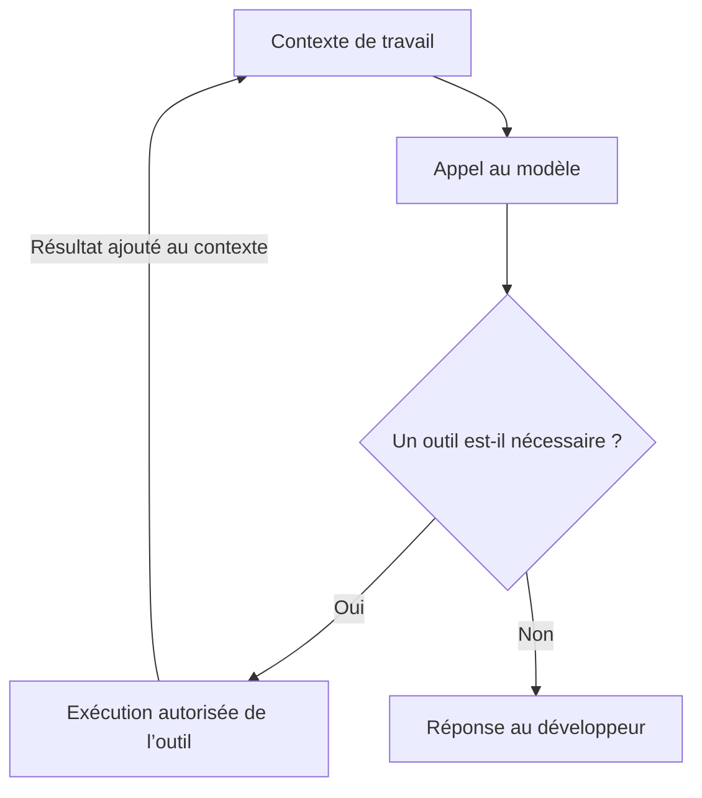

## Préambule

Tu demandes à GitHub Copilot de corriger un problème dans une application .NET. Il explore quelques fichiers, propose une modification, lance les tests et ajuste son code. Quelques minutes plus tard, il t’annonce que le travail est terminé.

De ton côté, tu as envoyé un seul message. Pourtant, cette demande a pu déclencher plusieurs appels au modèle et le traitement d’un volume de texte bien supérieur à celui de ton message.

Pour comprendre cette consommation, il faut regarder ce que l’agent reçoit à chaque étape, ce qu’il produit et ce qu’il transporte d’un appel au suivant. C’est là que les jetons, la fenêtre de contexte et le cache deviennent utiles à connaître.

Prenons GitHub Copilot comme point de départ, avec des exemples .NET et quelques parallèles avec Claude Code. L’objectif est de mieux employer ces outils tout en conservant la qualité du code, les validations et le contrôle sur les changements.

> Les fonctionnalités et les modalités de facturation présentées correspondent à la documentation consultée le 3 novembre 2026. Les exemples d’interface concernent surtout Copilot dans VS Code. Certaines commandes et certains compteurs diffèrent dans Visual Studio, les autres IDE et les outils en ligne de commande.

## Jetons, contexte et crédits IA : trois notions différentes

### Un jeton est une unité de traitement

[Un jeton, ou *token*](https://docs.github.com/en/copilot/concepts/prompting-and-context/context-management), représente un morceau de contenu traité par le modèle. Pour le texte, il peut correspondre à un mot, à une partie de mot ou à de la ponctuation. Un mot ne correspond donc pas systématiquement à un jeton. Le découpage dépend du modèle et de son tokenizer.

Dans un projet .NET, les noms de classes, les expressions LINQ, les fichiers JSON et les traces d’exception contribuent tous à ce volume. Compter les lignes de code ou les mots de ton message donne une indication très approximative.

Il faut surtout distinguer trois mesures.

| Mesure | Ce qu’elle représente | Question à laquelle elle répond |
|---|---|---|
| Jetons consommés | Le volume traité ou généré pendant les appels | Combien de contenu a été utilisé ? |
| Fenêtre de contexte | La capacité disponible pour un appel au modèle | Qu’est-ce que le modèle peut prendre en compte maintenant ? |
| Crédits IA | L’unité de décompte commercial de Copilot pour les usages concernés | Quelle part de mon allocation ai-je consommée ? |

Une fenêtre de contexte occupée à 70 % ne signifie donc pas que tu as consommé 70 % de ton budget mensuel.

### Comment les jetons deviennent des crédits dans Copilot

Avec la [facturation à l’utilisation](https://docs.github.com/en/copilot/concepts/billing-and-usage/individuals/billing), GitHub calcule la consommation selon le modèle et les catégories de jetons, puis la convertit en GitHub AI Credits. La documentation indique qu’un crédit correspond à 0,01 $ US. Une allocation incluse dans un abonnement absorbe cette consommation avant les éventuels usages supplémentaires autorisés.

Le mode de décompte actif sur ton compte reste déterminant. Certains anciens abonnements annuels Pro et Pro+ peuvent encore utiliser une [facturation fondée sur les requêtes](https://docs.github.com/en/copilot/reference/copilot-billing/models-and-pricing). Un quota de requêtes, une quantité de jetons et un solde de crédits ne sont pas interchangeables.

Les fonctionnalités ont aussi leurs propres règles. Selon la [documentation actuelle](https://docs.github.com/en/copilot/concepts/billing-and-usage/individuals/billing), les complétions de code et les suggestions de prochaine modification ne sont pas facturées en crédits IA et demeurent illimitées dans les offres payantes. Il ne faut donc pas appliquer le calcul d’une session agentique à chaque suggestion affichée dans l’éditeur.

Enfin, sélectionner un modèle Claude dans Copilot reste un usage de Copilot. Utiliser Claude Code avec un abonnement Anthropic ou une clé API relève d’[un autre accès et d’autres modalités](https://code.visualstudio.com/docs/agents/concepts/language-models). Le nom du modèle ne suffit pas à déterminer qui facture quoi.

## Un message peut déclencher une boucle de travail complète

Dans une session agentique, le modèle peut demander de lire un fichier, de lancer une commande ou de modifier du code. Une couche logicielle appelée [*harness*, ou orchestrateur](https://code.visualstudio.com/docs/agents/concepts/agent-harnesses), prépare les appels, exécute les outils autorisés et remet leurs résultats au modèle. Elle maintient aussi l’état de la session.



Imaginons cette demande.

> Corrige le calcul des mandats actifs et vérifie les tests.

Copilot pourrait rechercher `MandatRepository`, lire l’entité `Mandat`, examiner les tests, modifier une comparaison, exécuter les tests, analyser un échec et apporter un second correctif. Les outils peuvent être regroupés ou exécutés selon différentes stratégies, mais plusieurs appels au modèle peuvent intervenir avant la réponse finale.

Le nombre de messages que tu tapes ne mesure donc pas le nombre d’appels réalisés. [La boucle](https://code.visualstudio.com/docs/agents/concepts/agent-harnesses) peut aussi être interrompue par une limite, une erreur ou une intervention du développeur.

## Pourquoi les longues conversations consomment davantage

[Le contexte préparé pour un appel](https://docs.github.com/en/copilot/concepts/prompting-and-context/context-management) peut contenir ton message, les instructions du projet, l’historique conservé, des extraits de fichiers et des résultats d’outils. L’application peut sélectionner, résumer ou retirer certains éléments. Elle n’envoie pas nécessairement tout le dépôt ni l’historique brut complet à chaque appel.

Ce qui reste dans le contexte peut toutefois être réutilisé pendant plusieurs appels. Un journal volumineux peut ainsi peser sur la suite du travail, même si tu ne demandes plus rien à son sujet.

Prenons une simulation simple, sans compaction, dans laquelle chaque étape ajoute 2 000 jetons au contexte d’entrée.

| Appel au modèle | Jetons d’entrée de cet appel | Entrées cumulées |
|---|---:|---:|
| 1 | 8 000 | 8 000 |
| 2 | 10 000 | 18 000 |
| 3 | 12 000 | 30 000 |
| 4 | 14 000 | 44 000 |
| 5 | 16 000 | 60 000 |

Au cinquième appel, l’entrée contient 16 000 jetons. Pourtant, les cinq appels ont déjà présenté un total de 60 000 jetons d’entrée au modèle.

Dans cette simulation, la croissance cumulée est quadratique, puisque chaque appel reprend une base de plus en plus grande. **Ce n’est pas une loi universelle de facturation.** Le cache, les résumés, les outils et les choix de l’agent changent le résultat réel. Il faut aussi ajouter les jetons de sortie.

La conséquence pratique est simple. Une question d’une ligne, posée dans une longue conversation, peut mobiliser beaucoup plus que cette seule ligne.

## Le cache réduit le coût d’une réutilisation

### Une partie déjà traitée peut être réutilisée

Le [cache de prompt](https://code.visualstudio.com/docs/agents/agent-troubleshooting/cache-explorer) permet au fournisseur de réutiliser le traitement d’un début de requête, appelé préfixe, lorsqu’il correspond à du contenu déjà mis en cache. Le bénéfice dépend du modèle et du fournisseur. Une modification au début de la requête peut réduire la partie réutilisable.

Cela explique pourquoi les catégories de jetons comptent autant que le total.

| Catégorie | Signification |
|---|---|
| Entrée non mise en cache | Contenu traité au tarif d’entrée ordinaire |
| Lecture du cache | Contenu réutilisé à partir d’un préfixe en cache |
| Écriture du cache | Contenu enregistré dans le cache, avec un tarif distinct lorsque le modèle le prévoit |
| Sortie | Contenu généré, avec le raisonnement comptabilisé selon les règles du modèle |

GitHub publie des [tarifs distincts](https://docs.github.com/en/copilot/reference/copilot-billing/models-and-pricing) pour l’entrée, la lecture du cache, certaines écritures du cache et la sortie. Les colonnes applicables varient selon le modèle.

Le contenu mis en cache continue de faire partie du contexte utilisé. Le cache ne transforme pas un historique encombré en contexte pertinent et ne constitue pas une mémoire permanente de ton dépôt.

### Un exemple de calcul

Voici un exemple entièrement fictif. Les prix servent uniquement à illustrer le calcul et ne correspondent pas à une offre précise.

| Catégorie | Quantité | Tarif fictif par million | Coût calculé |
|---|---:|---:|---:|
| Entrée ordinaire | 10 000 | 2,00 $ US | 0,020 $ US |
| Lecture du cache | 80 000 | 0,20 $ US | 0,016 $ US |
| Écriture du cache | 10 000 | 2,50 $ US | 0,025 $ US |
| Sortie | 4 000 | 10,00 $ US | 0,040 $ US |
| **Total** | **104 000** | | **0,101 $ US** |

Dans cet exemple, les trois catégories d’entrée sont disjointes. Un même jeton n’est pas compté à la fois comme entrée ordinaire et comme écriture du cache.

Avec la [conversion de Copilot](https://docs.github.com/en/copilot/reference/copilot-billing/models-and-pricing), ce coût représenterait **10,1 crédits IA**, avant tout ajustement applicable. Le calcul d’une session consiste ensuite à additionner ses appels, y compris les opérations auxiliaires facturées. Le montant consommé dans l’allocation incluse ne correspond pas nécessairement à une somme supplémentaire sur la facture.

### Une pause ou un changement peut modifier le bénéfice du cache

Le cache possède une durée de vie. L’API Claude documente notamment [des durées de cinq minutes et d’une heure](https://platform.claude.com/docs/en/build-with-claude/prompt-caching), avec des conditions et des tarifs distincts. Ces paramètres ne constituent pas une règle universelle pour Copilot. Après expiration du cache concerné, une nouvelle demande peut nécessiter de traiter et de remettre en cache une grande partie du contexte.

Changer de modèle, modifier les outils disponibles ou réorganiser les instructions peut aussi modifier [la réutilisation du cache](https://code.visualstudio.com/docs/agents/agent-troubleshooting/cache-explorer). [Une compaction](https://code.claude.com/docs/en/costs) réécrit une partie de l’historique et peut nécessiter la reconstruction du préfixe concerné. L’effet exact dépend de l’implémentation.

Choisis donc un environnement de travail cohérent au départ. Si un changement de modèle devient nécessaire pour réussir la tâche, fais-le. Conserver une mauvaise approche pour préserver le cache n’a aucun intérêt.

## Un bon prompt réduit surtout l’exploration inutile

Reprenons le correctif des mandats. Cette demande laisse beaucoup de décisions ouvertes.

> Améliore la gestion des mandats actifs.

Parles-tu de la requête SQL, de la validation, de l’interface, de la performance ou d’une règle métier ? Copilot devra chercher et formuler des hypothèses.

Voici une demande plus exploitable, dans un dépôt fictif nommé `GestionMandats`.

```text
Corrige MandatRepository.ObtenirMandatsActifs dans
src/GestionMandats.Infrastructure/MandatRepository.cs.

La méthode reçoit déjà une dateEffective de type DateOnly.
Un mandat est actif si sa date de début est antérieure ou égale
à dateEffective et si sa date de fin est absente ou supérieure
ou égale à dateEffective.

Le défaut observé concerne la journée de fin, exclue actuellement.

Les tests sont dans
tests/GestionMandats.Tests/MandatRepositoryTests.cs.

Couvre le jour avant le début, le jour du début, le jour de fin,
le lendemain de la fin et l’absence de date de fin.

Conserve la signature publique et les conventions du projet.
Lance les tests concernés, puis les validations de régression
requises par le dépôt. Signale tout contrôle impossible à exécuter.
```

Cette demande contient davantage de mots. Elle borne toutefois le problème, précise la règle et fournit une cible de validation. Mon objectif ici est de réduire les recherches et les reprises que provoquerait l’ambiguïté.

L’expression métier attendue peut être décrite ainsi, en supposant `DateDebut` de type `DateOnly` et `DateFin` de type `DateOnly?`.

```csharp
x.DateDebut <= dateEffective &&
(x.DateFin == null || x.DateFin >= dateEffective)
```

Il s’agit d’une expression de prédicat à intégrer au code existant. Le travail de l’agent consiste ensuite à l’appliquer correctement dans le dépôt et à vérifier le comportement, notamment avec le fournisseur EF Core utilisé.

Quand tu connais les fichiers, joins-les ou indique leurs chemins. Quand tu ignores l’origine du problème, fournis plutôt [le symptôme, l’erreur et la zone fonctionnelle](https://code.visualstudio.com/docs/agents/guides/optimize-usage). L’agent doit pouvoir élargir sa recherche si les faits l’exigent.

## Organiser les instructions pour charger le bon contenu

### Garder les conventions communes courtes

Dans Copilot, `.github/copilot-instructions.md` peut porter [les conventions générales du dépôt](https://code.visualstudio.com/docs/agent-customization/custom-instructions). Des fichiers sous `.github/instructions/` permettent de cibler certaines règles, notamment avec `applyTo`. Claude Code utilise principalement `CLAUDE.md` et ses mécanismes de règles. La découverte des fichiers dépend de l’outil sélectionné.

Pour notre solution .NET, les conventions générales pourraient préciser le rôle des projets, la commande de validation et les dépendances à conserver. Les règles de tests peuvent aller dans `.github/instructions/tests.instructions.md`.

```markdown
---
applyTo: "tests/**/*.cs"
---

- Utiliser xUnit et les bibliothèques déjà présentes.
- Déclarer les classes de tests sealed.
- Nommer les tests selon le comportement métier vérifié.
- Utiliser FakeTimeProvider lorsque le comportement dépend du temps.
- Couvrir les bornes inclusives des périodes métier.
```

Ce découpage donne une portée utile aux règles. Il n’y a aucun gain si tous les fichiers sont ensuite injectés systématiquement dans chaque conversation.

Évite aussi d’y recopier l’historique complet des décisions. Une courte orientation vers le document pertinent suffit souvent. Le détail sera consulté lorsque la tâche le demande.

### Réserver les skills aux procédures réutilisables

Un [skill](https://code.visualstudio.com/docs/agent-customization/agent-skills) regroupe une procédure et, au besoin, des scripts ou des ressources. Son nom et sa description servent à la découverte. Son contenu détaillé est chargé lorsqu’il est utilisé, puis ses ressources sont consultées selon les besoins. La description doit donc indiquer clairement ce qu’il fait et quand l’utiliser.

Une procédure de revue des migrations EF Core convient bien à ce format. Elle n’a pas besoin d’alourdir toutes les discussions sur les contrôleurs ou les DTO.

Dans `.github/skills/revoir-migration-ef-core/SKILL.md`, un exemple minimal serait le suivant.

```markdown
---
name: revoir-migration-ef-core
description: >-
  Examiner une migration EF Core et ses conséquences sur les données.
  À utiliser lors de la création ou de la revue d’une migration
  ou d’un changement de schéma SQL Server.
---

# Revoir une migration EF Core

1. Identifier les changements de schéma et les données concernées.
2. Examiner les contraintes, les index et les risques de perte de données.
3. Vérifier la compatibilité avec la version applicative précédente.
4. Proposer les validations et la stratégie de déploiement.
5. Produire un compte rendu sans appliquer la migration à une base distante.
```

Ce squelette doit être adapté au processus de l’équipe. Installer beaucoup de skills n’est pas entièrement neutre, puisque leurs métadonnées occupent aussi du contexte. [Vérifie leur déclenchement](https://code.visualstudio.com/docs/agent-customization/agent-skills) sur des demandes représentatives.

## Savoir continuer, compacter ou repartir

Ces trois actions répondent à des besoins différents.

| Situation | Action généralement appropriée |
|---|---|
| Tu poursuis le même correctif avec un contexte pertinent | Continuer la conversation |
| Tu changes de sujet | Ouvrir une nouvelle conversation |
| Tu poursuis une tâche longue, avec des décisions utiles à conserver | Compacter en précisant les éléments importants |
| L’agent s’est engagé dans une mauvaise direction | L’arrêter et reprendre depuis un état cohérent |

### Une nouvelle tâche mérite souvent une nouvelle conversation

Une fois notre problème de dates corrigé, une question sur la configuration d’Application Insights n’a pas besoin des anciennes traces de tests. [Commencer une nouvelle conversation](https://code.visualstudio.com/docs/agents/run/sessions/manage-sessions) évite de transporter cet historique. Les fichiers du projet et les instructions applicables demeurent disponibles.

Repartir avec un historique vide ne nécessite pas de résumer l’ancienne discussion. Cela ne rend pas les prochains appels gratuits et n’efface pas la consommation déjà réalisée.

### La compaction produit un résumé

[Compacter](https://docs.github.com/en/copilot/concepts/prompting-and-context/context-management) consiste à remplacer une partie de l’historique par un résumé pour poursuivre le travail. Copilot utilise un appel au modèle pour réaliser cette synthèse. Elle peut perdre des détails et consomme elle-même des ressources. Son intérêt se mesure sur les appels suivants, qui transportent moins de contenu.

La compaction peut [se déclencher automatiquement](https://code.visualstudio.com/docs/agents/run/sessions/manage-sessions) lorsque le contexte se remplit. Tu peux aussi la demander et orienter son résumé dans une interface compatible.

```text
/compact Conserve la règle des dates inclusives, les fichiers modifiés,
les tests exécutés et leurs résultats, ainsi que les validations restantes.
```

Les décisions durables gagnent aussi à être conservées dans les tests, le code ou une courte note du dépôt. Elles restent alors consultables après la fin de la conversation.

### Arrêter une mauvaise direction tôt

Si Copilot commence à remplacer toute la couche de persistance pour corriger une comparaison, interromps-le. Une série de messages correctifs peut accumuler des hypothèses devenues inutiles.

Dans VS Code, [**Fork Conversation**](https://code.visualstudio.com/docs/agents/run/sessions/manage-sessions) permet de repartir d’un message choisi. Un fork de toute la conversation reprend aussi ses essais ratés. Le choix du point de départ compte donc. Un fork ne garantit pas l’isolation ou le rétablissement des fichiers, notamment lorsqu’il partage le même worktree.

Dans Claude Code, [`/rewind`](https://code.claude.com/docs/en/checkpointing) permet de choisir une restauration de la conversation, du code suivi par les checkpoints ou des deux. Ces checkpoints ont des limites et ne remplacent pas Git. Vérifie toujours la cohérence entre le contexte repris et les fichiers réellement présents.

## Réduire le bruit des outils sans perdre les preuves

### Les sorties de tests font partie du contexte

Une suite de tests qui produit des milliers de lignes peut remplir la conversation avec très peu d’information utile. Demander ensuite à l’agent d’ignorer les succès ne retire pas le contenu déjà envoyé.

La réduction doit se faire avant l’entrée dans le contexte. Un script peut conserver le journal complet et ne retourner qu’un bilan, les erreurs pertinentes et le chemin des détails. Claude Code documente notamment [ce prétraitement avec des hooks](https://code.claude.com/docs/en/costs).

Pour notre exemple .NET, une première exécution ciblée avec VSTest pourrait utiliser cette commande Bash.

```bash
dotnet test tests/GestionMandats.Tests/GestionMandats.Tests.csproj \
  --filter "FullyQualifiedName~MandatRepositoryTests" \
  --verbosity minimal \
  --logger trx \
  --results-directory .artifacts/tests
```

Les options sont celles de [VSTest](https://learn.microsoft.com/en-us/dotnet/core/tools/dotnet-test-vstest). Un projet utilisant [Microsoft.Testing.Platform](https://learn.microsoft.com/en-us/dotnet/core/testing/unit-testing-with-dotnet-test) peut nécessiter une autre syntaxe. La verbosité minimale ne garantit pas à elle seule une sortie courte, notamment si les tests écrivent beaucoup de journaux.

Un script de synthèse utilisé par l’agent devrait préserver au minimum le code de sortie, le nombre de tests exécutés et échoués, les erreurs de compilation et les éléments nécessaires au diagnostic. Le fichier TRX et les journaux détaillés doivent rester accessibles. Un échec du processus ne doit jamais disparaître derrière un résumé rassurant.

Les tests ciblés accélèrent les itérations. La validation finale doit couvrir les conséquences du changement et respecter les contrôles du dépôt. Pour une requête EF Core, cela peut inclure des tests avec SQL Server afin de vérifier la traduction et le comportement réels.

### Choisir des outils qui renvoient l’information utile

Un serveur MCP peut apporter une capacité précieuse, par exemple consulter une définition d’API ou un système interne. Il ajoute aussi des outils à découvrir et des résultats à intégrer. [Certains clients chargent les définitions à la demande](https://code.claude.com/docs/en/costs), ce qui réduit leur présence initiale sans supprimer le coût de leurs réponses.

Pour le correctif des mandats, commence avec les outils qui permettent de rechercher le code, modifier les fichiers et lancer les tests. Si une consultation de données est nécessaire, demande une projection ciblée plutôt qu’un résultat contenant toutes les colonnes et des milliers de lignes.

Un script, une commande existante ou un outil MCP peuvent chacun convenir. Compare surtout la précision du résultat, son volume et [les accès nécessaires](https://code.visualstudio.com/docs/agents/run/approvals). Pour une analyse en lecture seule, configure des permissions de lecture au niveau du service et des identifiants. Une phrase dans le prompt ne remplace pas cette restriction.

### Déléguer une recherche volumineuse peut aider

[Un sous-agent](https://code.visualstudio.com/docs/agents/run/subagents) dispose de son propre contexte et peut retourner un résultat ciblé à l’agent principal. Cette séparation est utile pour explorer un gros journal ou rechercher les endroits où une règle de dates est appliquée. La délégation consomme toutefois des jetons et ajoute de la coordination.

Un mandat utile pourrait être le suivant.

```text
Recherche les filtres de mandats actifs dans la couche Infrastructure.
Retourne les chemins, les méthodes et les différences de traitement
des dates de début et de fin. Ne modifie aucun fichier.
```

L’agent principal reçoit alors une liste exploitable. Pour trouver une méthode dont tu connais déjà le nom, une recherche directe suffit généralement.

Le parallélisme peut réduire le délai d’attente, mais il ne garantit pas une économie. Plusieurs agents peuvent répéter la même exploration et accumuler chacun leur contexte. Il faut mesurer le coût total, y compris celui des sous-agents.

## Choisir le modèle selon le travail à réussir

### Le prix au jeton ne suffit pas

Un modèle peu coûteux peut convenir à une transformation bornée. Sur un problème difficile, ses essais, erreurs et reprises peuvent annuler cet avantage. Compare [le coût d’une tâche correctement terminée](https://code.visualstudio.com/docs/agents/guides/optimize-usage), avec un niveau de qualité constant.

Voici une grille de départ à valider dans ton environnement.

| Travail .NET | Choix à évaluer |
|---|---|
| Renommer un symbole avec des références connues | Refactoring de l’IDE |
| Produire un mapping simple en suivant un exemple existant | Modèle léger avec contexte précis |
| Corriger une règle métier localisée | Modèle fiable sur ce type de correctif |
| Analyser une concurrence EF Core intermittente | Modèle plus capable, avec traces et scénario reproductible |
| Concevoir une évolution d’architecture | Planification, modèle adapté à l’analyse et revue humaine |

Pour une modification mécanique dont tu connais l’emplacement et la nouvelle valeur, intervenir directement dans l’éditeur peut être le meilleur choix. Par exemple, remplacer une valeur connue dans un fichier de configuration ne nécessite pas forcément de réactiver une longue session agentique. Le commit et la revue assurent toujours la traçabilité du changement.

### Une réponse courte peut cacher beaucoup de travail

La longueur du message final ne représente pas toute la génération. Les modèles de raisonnement peuvent produire des [jetons de réflexion](https://platform.claude.com/docs/en/build-with-claude/thinking) non affichés intégralement. Leur traitement et leur facturation dépendent du modèle. Dans Claude, ces jetons sont facturés comme de la sortie.

Dans Copilot, [augmenter l’effort de raisonnement](https://github.blog/changelog/2026-06-04-larger-context-windows-and-configurable-reasoning-levels-for-github-copilot/) peut accroître la latence et la consommation de crédits. GitHub recommande les réglages par défaut pour les tâches courantes, avec un effort supérieur lorsque la complexité le justifie. Une plus grande fenêtre de contexte augmente aussi la capacité disponible sans rendre son utilisation gratuite.

Demander une réponse concise peut réduire le texte visible. Cela ne borne pas à lui seul les recherches, les appels d’outils ou le raisonnement nécessaires.

## Planifier les changements qui comportent des décisions

Pour le correctif localisé de notre exemple, les critères sont déjà précis. Une longue phase de planification apporterait peu. En revanche, une modification touchant l’API, le stockage et plusieurs consommateurs mérite une approche validée avant l’implémentation. [Le mode de planification de Copilot](https://code.visualstudio.com/docs/agents/run/planning) sert à explorer le projet et à proposer ce plan.

Supposons maintenant que l’équipe veuille unifier la notion de mandat actif dans plusieurs services. Le plan devrait préciser les comportements existants, la règle cible, les méthodes concernées, la compatibilité attendue et les validations nécessaires.

Cette étape consomme elle aussi des jetons. Son intérêt est d’éviter une implémentation fondée sur une décision non prise ou une hypothèse incorrecte.

Quand l’agent annonce avoir terminé, examine le diff et les preuves de validation. Pour nos dates inclusives, vérifie particulièrement le jour de début, le jour de fin, le lendemain et l’absence de date de fin. Une suite verte qui ne couvre pas ces comportements ne démontre pas que le défaut est corrigé.

Demander une relecture supplémentaire à un agent peut compléter cette démarche. Cela ne remplace pas l’examen des changements ni les tests pertinents.

## Mesurer les bons indicateurs

### Utiliser les compteurs de l’outil

Dans les versions compatibles de VS Code, tu peux consulter [les crédits d’une réponse](https://code.visualstudio.com/docs/agents/guides/optimize-usage), les informations de session et le tableau de bord Copilot. L’indicateur de contexte renseigne sur l’espace utilisé, alors que les totaux de consommation décrivent l’usage cumulé.

Les **Agent Debug Logs** permettent d’examiner les appels. Le [**Cache Explorer**](https://code.visualstudio.com/docs/agents/agent-troubleshooting/cache-explorer) aide à comprendre les divergences entre requêtes et les statistiques de cache disponibles. Si le fournisseur n’expose pas ces données, leur absence ne démontre pas que le cache est désactivé.

Dans Claude Code, [`/usage`](https://code.claude.com/docs/en/costs) présente les mesures disponibles selon la version et le mode d’accès. Un montant estimé à partir des tarifs API ne correspond pas automatiquement à une facture supplémentaire pour un abonnement.

Pour une intégration directe à l’API Claude, les champs `cache_read_input_tokens` et `cache_creation_input_tokens` permettent de [suivre les lectures et créations du cache](https://platform.claude.com/docs/en/build-with-claude/prompt-caching). Une première requête sans lecture de cache peut être normale.

Demander au modèle d’estimer sa propre consommation ne remplace pas ces mesures. Il peut les interpréter si elles lui sont fournies, mais il ne doit pas les inventer.

### Comparer plusieurs exécutions et mesurer la qualité à part

Les modèles sont [non déterministes](https://code.visualstudio.com/docs/agents/concepts/language-models). Une même tâche peut entraîner des chemins d’exploration et des résultats différents. Un seul essai ne suffit donc pas pour attribuer une différence de coût à la qualité d’un prompt ou au choix d’un modèle.

Pour une équipe .NET, je commencerais avec quelques tâches représentatives et un tableau comme celui-ci.

| Indicateur | Ce qu’il permet d’observer |
|---|---|
| Critères d’acceptation satisfaits | Le comportement livré |
| Défauts détectés en revue | La qualité au-delà des tests automatisés |
| Crédits consommés | Le coût mesuré de l’exécution |
| Jetons par catégorie, si disponibles | La contribution du contexte, du cache et de la sortie |
| Nombre de reprises | Le travail refait après une erreur ou une mauvaise hypothèse |
| Durée et temps humain de revue | Le coût opérationnel total |

Rejoue les tâches depuis le même état du dépôt, avec les mêmes critères et des conditions comparables. Indique si le cache était disponible. Change une variable à la fois, puis compare plusieurs résultats. Les écarts les plus élevés méritent autant d’attention que la médiane lorsqu’il faut préparer un budget.

Évite de classer les développeurs selon leur nombre brut de jetons. Une investigation difficile et une modification de DTO n’ont pas la même portée. La consommation doit être interprétée avec la nature du travail et le résultat obtenu.

## Une méthode quotidienne pour une utilisation saine

Avant de lancer une tâche, précise le résultat attendu, les contraintes et les preuves de réussite. Choisis le modèle et les outils nécessaires. Pendant l’exécution, surveille les explorations qui s’élargissent sans raison, les sorties volumineuses et les répétitions d’échecs. À la fin, vérifie les changements et conserve les décisions utiles dans le dépôt.

Pour le correctif des mandats, cela donne une séquence concrète.

1. Ouvrir une conversation consacrée au problème.
2. Fournir la règle inclusive, les fichiers connus et les cas limites.
3. Confirmer une approche courte si un point reste incertain.
4. Faire appliquer le correctif et exécuter les validations pertinentes.
5. Consulter un bilan de tests concis, avec accès aux détails.
6. Relire le diff et vérifier les comportements affectés.
7. Terminer la conversation lorsque la tâche est réellement complétée.

À l’échelle d’une équipe, ajoute des budgets, des alertes et des règles d’usage. Dans les offres Copilot Business et Enterprise concernées, [les allocations sont mutualisées au niveau de l’entité de facturation](https://docs.github.com/en/copilot/concepts/billing-and-usage/organizations-and-enterprises/billing). Les politiques et les budgets contrôlent l’accès à la consommation supplémentaire.

Un plafond protège le budget. Il ne résout pas une règle métier ambiguë, un dépôt difficile à explorer ou une suite de tests qui donne peu de rétroaction. Pour rendre la consommation plus prévisible, je travaillerais aussi sur le découpage des tâches, la lisibilité du code, la rapidité des tests et la taille des changements revus.

## Conclusion

Comprendre les jetons permet de voir le travail réel derrière une interaction avec GitHub Copilot. Ton message déclenche parfois une boucle complète dans laquelle l’agent lit, génère, exécute des outils et réutilise un contexte qui évolue.

Le cache réduit une partie du coût de réutilisation. Les instructions ciblées, les demandes précises et les sorties d’outils bien préparées réduisent le contenu inutile. Le choix du modèle, l’effort de raisonnement et la gestion des conversations influencent ensuite le coût de la tâche.

Ces principes s’appliquent aussi à Claude Code, tout en tenant compte de ses propres commandes, compteurs et modalités de facturation.

Pour notre application .NET, la réussite reste un correctif juste, vérifié et maintenable. **La bonne mesure est le coût d’un travail correctement terminé.** Des pratiques d’ingénierie solides rendent ce résultat plus facile à atteindre, pour le développeur comme pour l’agent.
